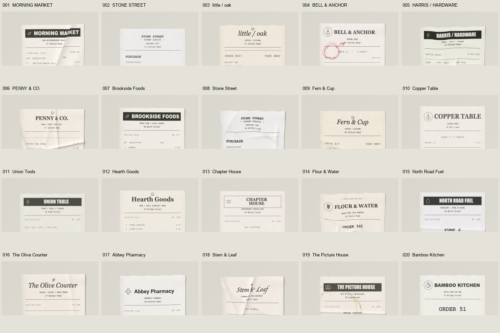
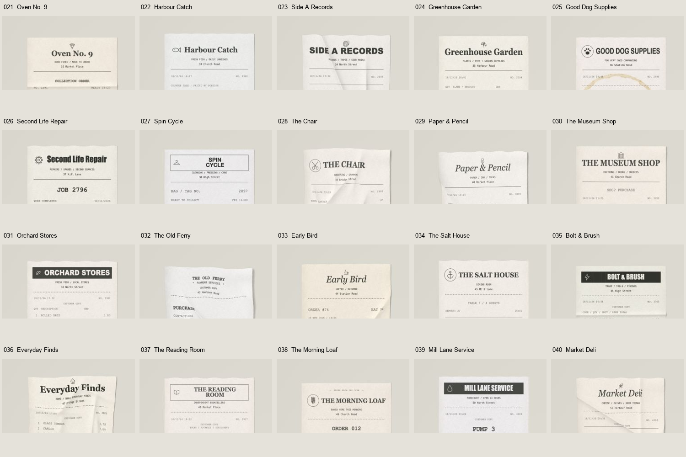
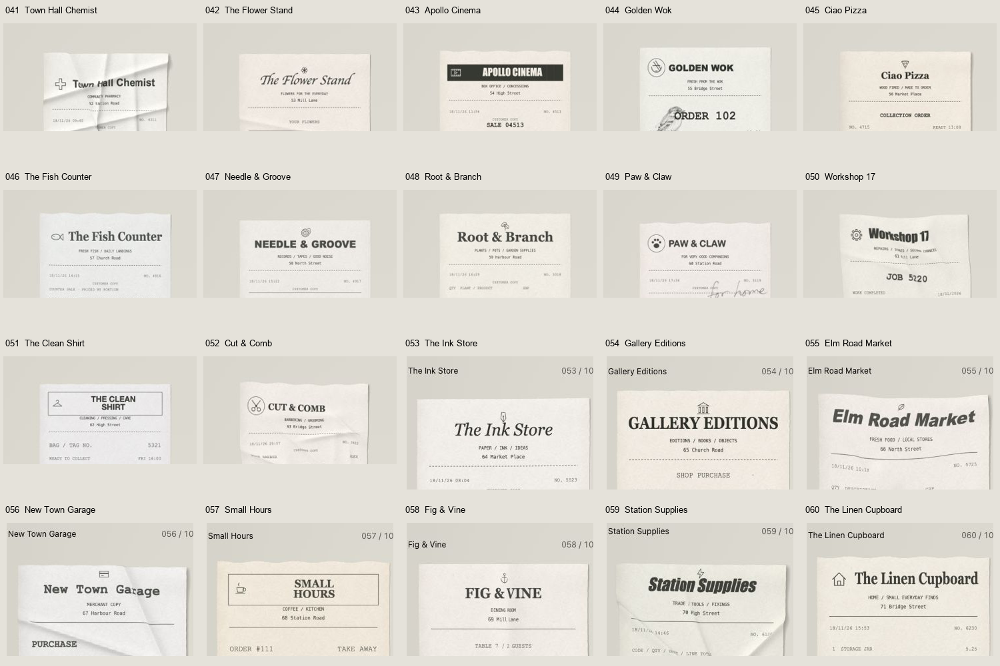
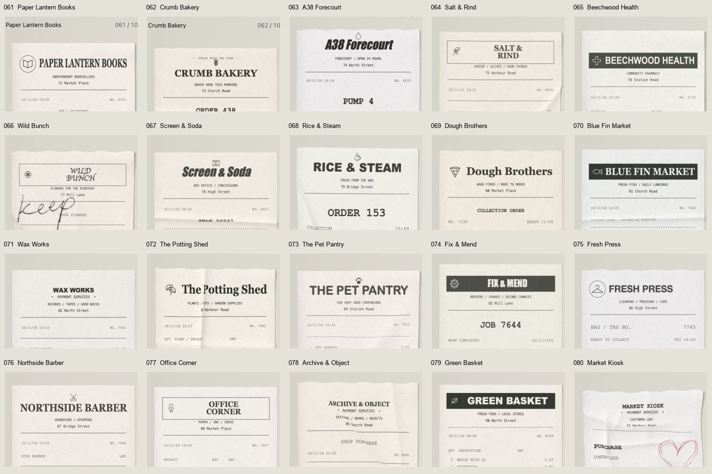
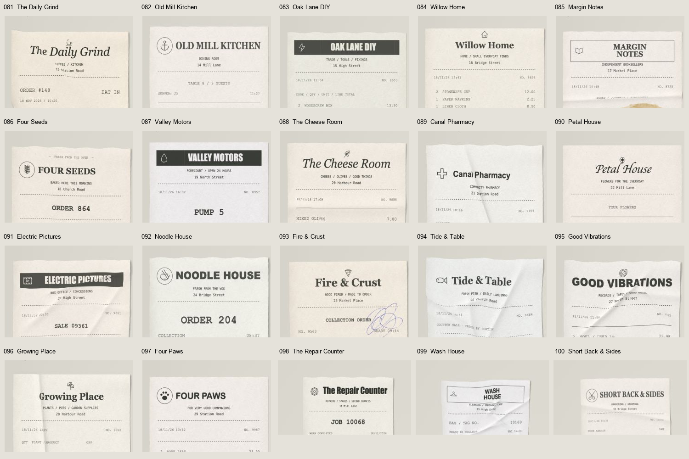

# Receipt logos: baseline, audit and research handoff

## Summary

The receipt bodies are accepted by Alex. The requested improvement concerns their logos: recognisable merchant identities, stronger symbols, more varied lettering and compositions, and less repeated framing. Any later regeneration is to change only logos.

This document completes the research and documentation scope authorised on 20 November 2026: record the receipt baseline, audit all 100 logos and prepare an annotated reference board. No prototype code or assets were edited. No replacement logos were designed, generated or integrated. No implementation is authorised by this report.

Verified: a 100-record data snapshot, source fingerprints, a mapped screenshot for every receipt, five contact sheets, source-derived style/font counts and a visual review of the sheets. The images support a collection-level review; no claim is made that every fine detail has been inspected at close-up size. Retention judgements and proposed directions below are recommendations awaiting Alex's visual approval.

Most merchants in a category share a font and symbol, which makes their headers feel related. Individual merchant identities need deliberate decisions about lettering, symbols and composition.

## Evidence

### 1. Receipt baseline and preservation boundary

**Checkout:** branch `receipt-portrait-paper-alternatives`, HEAD `c2b90a34cb0b35a1921bb7a18b0abd7d5286a625`. The working tree was already dirty. HEAD alone does not reproduce this baseline. Existing changes include paper-type selection and a separate library borrowing-card collection. This task concerns paper type **Receipts** only.

The [evidence inventory](../references/receipt-logos/README.md) explains the attached files. The [baseline data](../references/receipt-logos/baseline.json) records every stable ID, ordinal, merchant title and current receipt properties. The [fingerprints](../references/receipt-logos/source-fingerprints.json) identify the exact files inspected. The numbered JPEGs retain the captured bodies as well as their logos.

| Preserve in later logo work | Owning evidence/source |
|---|---|
| All 100 stable IDs, collection order, names and existing transaction data | Baseline JSON; [catalogue](../../prototypes/second-impression/catalogue.js), [additional families](../../prototypes/second-impression/extra-families.js), [receipt records](../../prototypes/second-impression/receipts.js) |
| Item descriptions, quantities, prices, totals, addresses, receipt subtitles and body typography | Numbered captures; [original layouts](../../prototypes/second-impression/layouts.js), [collection layouts](../../prototypes/second-impression/collection-layouts.js), [additional layouts](../../prototypes/second-impression/extra-layouts.js) |
| Dimensions, tint, seed, ink density, cut edges, folds, bumps, curl and other condition fields | Baseline JSON; [conditions](../../prototypes/second-impression/conditions.js) |
| Existing stains, notes, strokes and doodles, including their assignments | Baseline JSON; [mark placement](../../prototypes/second-impression/marks.js), [mark assets](../../prototypes/second-impression/mark-assets.js) |
| Paper texture, lighting, shadows, geometry and print/camera behaviour | Fingerprinted source/assets; [production guide](../../prototypes/second-impression/production-guide.md) |
| Library borrowing cards and paper-type selection behaviour | Outside the requested change; existing working-tree work |

The six originals remain identifiable as `grocer`, `terminal`, `cafe`, `restaurant`, `hardware` and `coupon`. Their body transactions are drawn by layout code, rather than stored as complete item arrays in the exported records. The layout fingerprints and images complement the data snapshot.

**Logo-only boundary for a future implementation.** The existing [header function](../../prototypes/second-impression/brands.js) draws the identity, subtitle, address and divider together. Replacing that entire header is too broad. The logo area needs an explicit boundary for each receipt layout, preserving those other elements at their present positions. Header baselines vary: 58 for several families, 74 for cafés/books/delis, 85 for bakeries and 101 for pharmacies, among others. Bakery receipts also have a preamble at authoring y=34 above the logo. A universal rectangular replacement could erase that line or move other content.

Recommended future proof: retain the original rendered paper texture, replace only the agreed logo region, and compare before/after pixel values outside its mask. Separately compare the full receipt data, physical properties and source changes. Use identical fonts, rendering environment, viewport and held print for comparisons. Today's captures have varying viewport sizes and are not pixel-difference fixtures. No before/after isolation test has been run because no logo replacement exists.

“Regeneration” is interpreted here as an authoring operation: select or replace a merchant identity while retaining that receipt's existing content and physical state. This report does not propose a new user-facing randomisation control.

### 2. Audit of the current collection

The audit combines the actual record catalogue, the drawing logic and the five rendered contact sheets below. Numbers are collection positions; stable IDs in the detailed register are the reliable keys for another agent.

#### Collection findings

| Current arrangement | Style in source | Receipts |
|---|---:|---:|
| Mark above, mixed-case wordmark | 0 | 11 |
| Leading mark, mixed-case wordmark | 1 | 12 |
| Black rectangular panel, leading mark and capitals | 2 | 17 |
| Small mark above, italic wordmark | 3 | 16 |
| Outlined rectangle, leading mark, two-line capitals | 4 | 10 |
| Circular badge beside capitalised wordmark | 5 | 18 |
| Mark above, capitalised wordmark | 6 | 10 |
| Small text heading and PAYMENT SERVICES line | 7 | 6 |
| **Total** | | **100** |

There are eight code branches, but styles 0/6 are closely related. The 100 records contain 99 distinct displayed merchant names when case is ignored: the original terminal and terminal-01 both display Stone Street. Those two receipts can appropriately share an identity; uniqueness should be judged per merchant, not forced per ticket. Of the 100 headers, 94 include a symbol. The six text-only headers use the small terminal-style treatment; there are no symbol-only identities. Seventeen black panels, ten rectangular frames and eighteen circular badges make 45 headers with one of those repeated container treatments. The rendered black panels can look grey because existing ink density and material effects remain active; these are not separately designed grey identities.

The font-stack assignments are: Georgia 49, Impact 17, Arial Black 13, Courier New 5, and four each for Arial, Apple Chancery, Arial Rounded MT Bold and Helvetica Neue. These are requested font stacks, not a cross-platform measurement of the fonts actually resolved by the browser. The wordmark helper requests bold for most styles and italic for style 3. Regular-weight serif variation is therefore absent from this helper. Long lettering is horizontally compressed to fit, which can weaken the character of the chosen face.

The mark system supplies one category pictogram per family. Its common line width and outline construction make many symbols resemble a coherent icon set. Above-name marks are often only about 0.55–0.6 of their authoring size, reinforcing the small decorative-icon effect. The paw is a useful counterexample: its filled mass remains visible, though repeated use still links different pet shops together.

The third merchant variant changes to the next style without changing the family font or mark. This produces some variety, but also lets the PAYMENT SERVICES line appear under **Wax Works** (071, records) and **Archive & Object** (078, museum shop). These are existing identity-template defects. Any later correction needs to be explicitly included in the logo-region replacement; body copy remains protected.

#### Visual evidence

Headers are cropped for comparison; full receipt captures are linked from every register row. At this review scale, `little / oak`, The Flower Stand, Second Life Repair and several plain terminal headings are useful retention candidates. This is not approval to discard every other identity or to preserve those candidates unchanged.

#### Register of all 100 logos

`Retain candidate` means keep as a useful starting point for Alex's review. `Reconsider` means address a visible or structural weakness. Neither is a final design decision. Style numbers refer to the table above. Notes identify the current issue or quality, rather than assigning a finished replacement.

| No. / capture | Stable ID | Displayed merchant | Style / font stack | Review | Audit note |
|---|---|---|---|---|---|
| [001](../references/receipt-logos/receipt-001.jpg) | `grocer` | MORNING MARKET | 2 / Arial Black | Retain candidate | One strong reverse grocery heading could remain; the leaf is still generic. Keep this distinct from the other grocery identities. |
| [002](../references/receipt-logos/receipt-002.jpg) | `terminal` | STONE STREET | 7 / Courier New | Retain candidate | Quiet mono terminal heading is credible. Displays STONE STREET; coordinate its identity with 008. |
| [003](../references/receipt-logos/receipt-003.jpg) | `cafe` | little / oak | 3 / Georgia | Retain candidate | Lowercase name and slash already have character. Tiny cup could be reconsidered without losing the lettering direction. |
| [004](../references/receipt-logos/receipt-004.jpg) | `restaurant` | BELL & ANCHOR | 5 / Georgia | Reconsider | Shared anchor and serif construction links unrelated restaurants. |
| [005](../references/receipt-logos/receipt-005.jpg) | `hardware` | HARRIS / HARDWARE | 2 / Impact | Reconsider | Bolt reads as a category icon; Impact and panel repeat across the trade. |
| [006](../references/receipt-logos/receipt-006.jpg) | `coupon` | PENNY & CO. | 0 / Georgia | Reconsider | Shared house ornament gives different shops the same domestic identity. |
| [007](../references/receipt-logos/receipt-007.jpg) | `grocer-01` | Brookside Foods | 2 / Arial Black | Reconsider | Shared leaf and wide grocery heading; panel/lettering repetition dominates. |
| [008](../references/receipt-logos/receipt-008.jpg) | `terminal-01` | Stone Street | 7 / Courier New | Retain candidate | Same displayed merchant as 002; consistent identity across those two receipts is appropriate. |
| [009](../references/receipt-logos/receipt-009.jpg) | `cafe-01` | Fern & Cup | 3 / Georgia | Reconsider | Pleasant italic name, but the small cup and Georgia repeat across cafés. |
| [010](../references/receipt-logos/receipt-010.jpg) | `restaurant-01` | Copper Table | 5 / Georgia | Reconsider | Shared anchor and serif construction links unrelated restaurants. |
| [011](../references/receipt-logos/receipt-011.jpg) | `hardware-01` | Union Tools | 2 / Impact | Reconsider | Bolt reads as a category icon; Impact and panel repeat across the trade. |
| [012](../references/receipt-logos/receipt-012.jpg) | `coupon-01` | Hearth Goods | 0 / Georgia | Reconsider | Shared house ornament gives different shops the same domestic identity. |
| [013](../references/receipt-logos/receipt-013.jpg) | `books-01` | Chapter House | 4 / Georgia | Reconsider | Book pictogram and rigid frame feel like a shared template. |
| [014](../references/receipt-logos/receipt-014.jpg) | `bakery-01` | Flour & Water | 5 / Georgia | Reconsider | Wheat badge and serif capitals repeat; preserve the preamble above the identity. |
| [015](../references/receipt-logos/receipt-015.jpg) | `petrol-01` | North Road Fuel | 2 / Impact | Reconsider | Droplet and narrow capitals repeat a forecourt template. |
| [016](../references/receipt-logos/receipt-016.jpg) | `deli-01` | The Olive Counter | 3 / Georgia | Reconsider | Readable italic name; tiny delicatessen ornament adds little identity. |
| [017](../references/receipt-logos/receipt-017.jpg) | `pharmacy-01` | Abbey Pharmacy | 1 / Arial | Reconsider | Cross is recognisable category signage; lettering needs merchant-specific character. |
| [018](../references/receipt-logos/receipt-018.jpg) | `florist-01` | Stem & Leaf | 3 / Apple Chancery | Reconsider | Script contributes variety, but the same small flower repeats. |
| [019](../references/receipt-logos/receipt-019.jpg) | `cinema-01` | The Picture House | 2 / Impact | Reconsider | Film pictogram and Impact panel repeat across venues. |
| [020](../references/receipt-logos/receipt-020.jpg) | `takeaway-01` | Bamboo Kitchen | 5 / Arial Black | Reconsider | Bowl/chopstick badge and heavy capitals repeat across shops. |
| [021](../references/receipt-logos/receipt-021.jpg) | `pizza-01` | Oven No. 9 | 0 / Georgia | Reconsider | Small pizza ornament and bold serif produce a shared pizzeria identity. |
| [022](../references/receipt-logos/receipt-022.jpg) | `fish-01` | Harbour Catch | 1 / Georgia | Reconsider | Thin fish reads as a category icon; the same serif repeats. |
| [023](../references/receipt-logos/receipt-023.jpg) | `records-01` | Side A Records | 6 / Arial Black | Reconsider | Heavy sans has useful presence; tiny vinyl ornament is shared. |
| [024](../references/receipt-logos/receipt-024.jpg) | `garden-01` | Greenhouse Garden | 0 / Georgia | Reconsider | Small sprout over bold serif is shared by all garden shops. |
| [025](../references/receipt-logos/receipt-025.jpg) | `pets-01` | Good Dog Supplies | 5 / Arial Rounded | Reconsider | Filled paw survives reduction, but the shared badge links unrelated shops. |
| [026](../references/receipt-logos/receipt-026.jpg) | `repair-01` | Second Life Repair | 1 / Impact | Retain candidate | Condensed name has convincing trade character at receipt size. Gear remains a generic category mark. |
| [027](../references/receipt-logos/receipt-027.jpg) | `laundry-01` | Spin Cycle | 4 / Helvetica Neue | Reconsider | Hanger and outlined two-line panel read as one shared laundry template. |
| [028](../references/receipt-logos/receipt-028.jpg) | `barber-01` | The Chair | 5 / Georgia | Reconsider | Scissors in a circle and bold serif repeat a barber template. |
| [029](../references/receipt-logos/receipt-029.jpg) | `stationery-01` | Paper & Pencil | 3 / Georgia | Reconsider | Italic serif and small nib repeat a category-level identity. |
| [030](../references/receipt-logos/receipt-030.jpg) | `museum-01` | The Museum Shop | 6 / Georgia | Reconsider | Bold serif and small column share an institutional template. |
| [031](../references/receipt-logos/receipt-031.jpg) | `grocer-02` | Orchard Stores | 2 / Arial Black | Reconsider | Shared leaf and wide grocery heading; panel/lettering repetition dominates. |
| [032](../references/receipt-logos/receipt-032.jpg) | `terminal-02` | The Old Ferry | 7 / Courier New | Retain candidate | Plain mono heading supports an ordinary terminal slip. No need to make every payment heading decorative. |
| [033](../references/receipt-logos/receipt-033.jpg) | `cafe-02` | Early Bird | 3 / Georgia | Reconsider | Pleasant italic name, but the small cup and Georgia repeat across cafés. |
| [034](../references/receipt-logos/receipt-034.jpg) | `restaurant-02` | The Salt House | 5 / Georgia | Reconsider | Shared anchor and serif construction links unrelated restaurants. |
| [035](../references/receipt-logos/receipt-035.jpg) | `hardware-02` | Bolt & Brush | 2 / Impact | Reconsider | Bolt reads as a category icon; Impact and panel repeat across the trade. |
| [036](../references/receipt-logos/receipt-036.jpg) | `coupon-02` | Everyday Finds | 0 / Georgia | Reconsider | Shared house ornament gives different shops the same domestic identity. |
| [037](../references/receipt-logos/receipt-037.jpg) | `books-02` | The Reading Room | 4 / Georgia | Reconsider | Book pictogram and rigid frame feel like a shared template. |
| [038](../references/receipt-logos/receipt-038.jpg) | `bakery-02` | The Morning Loaf | 5 / Georgia | Reconsider | Wheat badge and serif capitals repeat; preserve the preamble above the identity. |
| [039](../references/receipt-logos/receipt-039.jpg) | `petrol-02` | Mill Lane Service | 2 / Impact | Reconsider | Droplet and narrow capitals repeat a forecourt template. |
| [040](../references/receipt-logos/receipt-040.jpg) | `deli-02` | Market Deli | 3 / Georgia | Reconsider | Readable italic name; tiny delicatessen ornament adds little identity. |
| [041](../references/receipt-logos/receipt-041.jpg) | `pharmacy-02` | Town Hall Chemist | 1 / Arial | Reconsider | Cross is recognisable category signage; lettering needs merchant-specific character. |
| [042](../references/receipt-logos/receipt-042.jpg) | `florist-02` | The Flower Stand | 3 / Apple Chancery | Retain candidate | Flowing name gives this receipt a clear visual contrast. Flower remains a shared miniature ornament. |
| [043](../references/receipt-logos/receipt-043.jpg) | `cinema-02` | Apollo Cinema | 2 / Impact | Reconsider | Film pictogram and Impact panel repeat across venues. |
| [044](../references/receipt-logos/receipt-044.jpg) | `takeaway-02` | Golden Wok | 5 / Arial Black | Reconsider | Bowl/chopstick badge and heavy capitals repeat across shops. |
| [045](../references/receipt-logos/receipt-045.jpg) | `pizza-02` | Ciao Pizza | 0 / Georgia | Reconsider | Small pizza ornament and bold serif produce a shared pizzeria identity. |
| [046](../references/receipt-logos/receipt-046.jpg) | `fish-02` | The Fish Counter | 1 / Georgia | Reconsider | Thin fish reads as a category icon; the same serif repeats. |
| [047](../references/receipt-logos/receipt-047.jpg) | `records-02` | Needle & Groove | 6 / Arial Black | Reconsider | Heavy sans has useful presence; tiny vinyl ornament is shared. |
| [048](../references/receipt-logos/receipt-048.jpg) | `garden-02` | Root & Branch | 0 / Georgia | Reconsider | Small sprout over bold serif is shared by all garden shops. |
| [049](../references/receipt-logos/receipt-049.jpg) | `pets-02` | Paw & Claw | 5 / Arial Rounded | Reconsider | Filled paw survives reduction, but the shared badge links unrelated shops. |
| [050](../references/receipt-logos/receipt-050.jpg) | `repair-02` | Workshop 17 | 1 / Impact | Reconsider | Condensed lettering has useful trade character; generic gear repeats. |
| [051](../references/receipt-logos/receipt-051.jpg) | `laundry-02` | The Clean Shirt | 4 / Helvetica Neue | Reconsider | Hanger and outlined two-line panel read as one shared laundry template. |
| [052](../references/receipt-logos/receipt-052.jpg) | `barber-02` | Cut & Comb | 5 / Georgia | Reconsider | Scissors in a circle and bold serif repeat a barber template. |
| [053](../references/receipt-logos/receipt-053.jpg) | `stationery-02` | The Ink Store | 3 / Georgia | Reconsider | Italic lettering is readable, but the small nib is ornamental and repeats Paper & Pencil. |
| [054](../references/receipt-logos/receipt-054.jpg) | `museum-02` | Gallery Editions | 6 / Georgia | Reconsider | Strong serif name but a tiny shared column; institutional identity relies mostly on the type. |
| [055](../references/receipt-logos/receipt-055.jpg) | `grocer-03` | Elm Road Market | 3 / Arial Black | Reconsider | Italic heavy sans changes tone, but a tiny leaf remains. Automatic style progression does not establish a new identity. |
| [056](../references/receipt-logos/receipt-056.jpg) | `terminal-03` | New Town Garage | 0 / Courier New | Reconsider | Large mono name has a useful plain direction; miniature payment-card symbol is literal category imagery. |
| [057](../references/receipt-logos/receipt-057.jpg) | `cafe-03` | Small Hours | 4 / Georgia | Reconsider | Two-line name has potential; the rigid rectangle and small cup are inherited template features. |
| [058](../references/receipt-logos/receipt-058.jpg) | `restaurant-03` | Fig & Vine | 6 / Georgia | Reconsider | Stacked anchor is still a small shared ornament; bold serif alone supplies most identity. |
| [059](../references/receipt-logos/receipt-059.jpg) | `hardware-03` | Station Supplies | 3 / Impact | Reconsider | Impact italic offers useful contrast; small bolt remains a stock-like symbol. |
| [060](../references/receipt-logos/receipt-060.jpg) | `coupon-03` | The Linen Cupboard | 1 / Georgia | Reconsider | Leading house is larger than above-name ornaments but still repeats the home-shop category mark. |
| [061](../references/receipt-logos/receipt-061.jpg) | `books-03` | Paper Lantern Books | 5 / Georgia | Reconsider | Book symbol in a circle plus narrow serif name feels like a template variation; inspect name proportions before reuse. |
| [062](../references/receipt-logos/receipt-062.jpg) | `bakery-03` | Crumb Bakery | 6 / Georgia | Reconsider | Above-name wheat is especially small; name and bakery preamble need to retain their separate roles. |
| [063](../references/receipt-logos/receipt-063.jpg) | `petrol-03` | A38 Forecourt | 3 / Impact | Reconsider | Italic condensed name provides contrast; droplet above remains a small industry icon. |
| [064](../references/receipt-logos/receipt-064.jpg) | `deli-03` | Salt & Rind | 4 / Georgia | Reconsider | Two-line name has useful grouping, but the rectangular frame and tiny mark repeat the framed branch. |
| [065](../references/receipt-logos/receipt-065.jpg) | `pharmacy-03` | Beechwood Health | 2 / Arial | Reconsider | Reverse cross and name introduce another black panel. Cross needs deliberate visual weight if retained. |
| [066](../references/receipt-logos/receipt-066.jpg) | `florist-03` | Wild Bunch | 4 / Apple Chancery | Reconsider | Two-line script is promising; outlined rectangle and small flower feel mechanically combined. |
| [067](../references/receipt-logos/receipt-067.jpg) | `cinema-03` | Screen & Soda | 3 / Impact | Reconsider | Italic condensed name changes the cinema tone, but the tiny film symbol is inherited. |
| [068](../references/receipt-logos/receipt-068.jpg) | `takeaway-03` | Rice & Steam | 6 / Arial Black | Reconsider | Above-name bowl remains small beside broad heavy lettering; category identity persists. |
| [069](../references/receipt-logos/receipt-069.jpg) | `pizza-03` | Dough Brothers | 1 / Georgia | Reconsider | Leading pizza slice is larger, but still a generic category pictogram beside the same serif. |
| [070](../references/receipt-logos/receipt-070.jpg) | `fish-03` | Blue Fin Market | 2 / Georgia | Reconsider | Reverse fish/name is another black rectangle; the symbol remains thin relative to the wordmark. |
| [071](../references/receipt-logos/receipt-071.jpg) | `records-03` | Wax Works | 7 / Arial Black | Reconsider | Text-only name could work, but PAYMENT SERVICES is an inappropriate inherited logo-template line. |
| [072](../references/receipt-logos/receipt-072.jpg) | `garden-03` | The Potting Shed | 1 / Georgia | Reconsider | Leading sprout has more presence, but the same drawing and serif still link the garden shops. |
| [073](../references/receipt-logos/receipt-073.jpg) | `pets-03` | The Pet Pantry | 6 / Arial Rounded | Reconsider | Filled paw is more visible than thin-line marks, yet remains a small above-name category ornament. |
| [074](../references/receipt-logos/receipt-074.jpg) | `repair-03` | Fix & Mend | 2 / Impact | Reconsider | Reverse condensed name could be useful selectively; the shared gear/panel is another repeated formula. |
| [075](../references/receipt-logos/receipt-075.jpg) | `laundry-03` | Fresh Press | 5 / Helvetica Neue | Reconsider | Large hanger badge is clearer, but this merely changes the inherited frame to a circle. |
| [076](../references/receipt-logos/receipt-076.jpg) | `barber-03` | Northside Barber | 6 / Georgia | Reconsider | Scissors above serif name remain a miniature shared symbol; explore a merchant-specific relationship. |
| [077](../references/receipt-logos/receipt-077.jpg) | `stationery-03` | Office Corner | 4 / Georgia | Reconsider | Two-line name is legible; large rectangle and small nib repeat the framed branch. |
| [078](../references/receipt-logos/receipt-078.jpg) | `museum-03` | Archive & Object | 7 / Georgia | Reconsider | Text-only serif name could work, but PAYMENT SERVICES is an inappropriate inherited logo-template line. |
| [079](../references/receipt-logos/receipt-079.jpg) | `grocer-04` | Green Basket | 2 / Arial Black | Reconsider | Shared leaf and wide grocery heading; panel/lettering repetition dominates. |
| [080](../references/receipt-logos/receipt-080.jpg) | `terminal-04` | Market Kiosk | 7 / Courier New | Retain candidate | Plain payment-slip name helps retain ordinary receipts within the collection. |
| [081](../references/receipt-logos/receipt-081.jpg) | `cafe-04` | The Daily Grind | 3 / Georgia | Reconsider | Pleasant italic name, but the small cup and Georgia repeat across cafés. |
| [082](../references/receipt-logos/receipt-082.jpg) | `restaurant-04` | Old Mill Kitchen | 5 / Georgia | Reconsider | Shared anchor and serif construction links unrelated restaurants. |
| [083](../references/receipt-logos/receipt-083.jpg) | `hardware-04` | Oak Lane DIY | 2 / Impact | Reconsider | Bolt reads as a category icon; Impact and panel repeat across the trade. |
| [084](../references/receipt-logos/receipt-084.jpg) | `coupon-04` | Willow Home | 0 / Georgia | Reconsider | Shared house ornament gives different shops the same domestic identity. |
| [085](../references/receipt-logos/receipt-085.jpg) | `books-04` | Margin Notes | 4 / Georgia | Reconsider | Book pictogram and rigid frame feel like a shared template. |
| [086](../references/receipt-logos/receipt-086.jpg) | `bakery-04` | Four Seeds | 5 / Georgia | Reconsider | Wheat badge and serif capitals repeat; preserve the preamble above the identity. |
| [087](../references/receipt-logos/receipt-087.jpg) | `petrol-04` | Valley Motors | 2 / Impact | Reconsider | Droplet and narrow capitals repeat a forecourt template. |
| [088](../references/receipt-logos/receipt-088.jpg) | `deli-04` | The Cheese Room | 3 / Georgia | Reconsider | Readable italic name; tiny delicatessen ornament adds little identity. |
| [089](../references/receipt-logos/receipt-089.jpg) | `pharmacy-04` | Canal Pharmacy | 1 / Arial | Reconsider | Cross is recognisable category signage; lettering needs merchant-specific character. |
| [090](../references/receipt-logos/receipt-090.jpg) | `florist-04` | Petal House | 3 / Apple Chancery | Reconsider | Script contributes variety, but the same small flower repeats. |
| [091](../references/receipt-logos/receipt-091.jpg) | `cinema-04` | Electric Pictures | 2 / Impact | Reconsider | Film pictogram and Impact panel repeat across venues. |
| [092](../references/receipt-logos/receipt-092.jpg) | `takeaway-04` | Noodle House | 5 / Arial Black | Reconsider | Bowl/chopstick badge and heavy capitals repeat across shops. |
| [093](../references/receipt-logos/receipt-093.jpg) | `pizza-04` | Fire & Crust | 0 / Georgia | Reconsider | Small pizza ornament and bold serif produce a shared pizzeria identity. |
| [094](../references/receipt-logos/receipt-094.jpg) | `fish-04` | Tide & Table | 1 / Georgia | Reconsider | Thin fish reads as a category icon; the same serif repeats. |
| [095](../references/receipt-logos/receipt-095.jpg) | `records-04` | Good Vibrations | 6 / Arial Black | Reconsider | Heavy sans has useful presence; tiny vinyl ornament is shared. |
| [096](../references/receipt-logos/receipt-096.jpg) | `garden-04` | Growing Place | 0 / Georgia | Reconsider | Small sprout over bold serif is shared by all garden shops. |
| [097](../references/receipt-logos/receipt-097.jpg) | `pets-04` | Four Paws | 5 / Arial Rounded | Reconsider | Filled paw survives reduction, but the shared badge links unrelated shops. |
| [098](../references/receipt-logos/receipt-098.jpg) | `repair-04` | The Repair Counter | 1 / Impact | Reconsider | Condensed lettering has useful trade character; generic gear repeats. |
| [099](../references/receipt-logos/receipt-099.jpg) | `laundry-04` | Wash House | 4 / Helvetica Neue | Reconsider | Hanger and outlined two-line panel read as one shared laundry template. |
| [100](../references/receipt-logos/receipt-100.jpg) | `barber-04` | Short Back & Sides | 5 / Georgia | Reconsider | Long capitalised name is notably condensed to fit. Revisit lettering/line grouping before changing symbol scale. |

### 3. Annotated reference board

This is a **linked reference board**: primary case studies/specimens with specific lessons and proposed uses. External logo images were not bundled; the case-study image endpoints could not be retrieved by the research tool. The linked pages contain the source visuals. These references establish possibilities, not evidence of how those brands appear on thermal receipts. No merchant artwork or lettering is proposed for copying.

#### Lettering carries the identity

| Reference | Supported source detail | What to investigate for this collection |
|---|---|---|
| [Parla — Pentagram](https://www.pentagram.com/work/parla) | A custom, tightly spaced wordmark with expressive letterforms | A name with its own rhythm and silhouette. Useful for a lively café/bakery wordmark without a supporting category icon. |
| [Gato — Pentagram](https://www.pentagram.com/work/gato) | Lisbon lettering, including a modified G, gives the wordmark a stencil-like character | Distinctive letter construction can carry an identity. Explore a sturdy stencil/slab direction for one merchant, without making it the default for a whole trade. |
| [Endo — Pentagram](https://www.pentagram.com/work/endo) | Reduced letterforms form the logotype; the chef's initials form a separate monogram | A restrained name and an independent symbol can each be complete identities. Useful for a few quiet, minimal entries. |
| [Librería — Pentagram](https://www.pentagram.com/work/libreria) | Handwritten typography accompanies overlapping shapes | Handwritten lettering can be particular to a shop; italic serif should not stand in for every script or hand-drawn identity. |

#### Symbols with enough identity and presence

| Reference | Supported source detail | What to investigate for this collection |
|---|---|---|
| [Metropolis — Pentagram](https://www.pentagram.com/work/metropolis-by-marcus-samuelsson) | Architectural beams inform an M symbol paired with Ivar Display | A symbol can come from a merchant's name, place or history. Explore substantial mark/name relationships and contrasting serif lettering. |
| [Bookshop.org — Pentagram](https://www.pentagram.com/work/bookshop-org) | Two books form a B | A familiar category object can become a distinct constructed symbol. Develop original forms with a clear silhouette rather than a small stock book outline. |
| [Burger King — JKR](https://www.jkrglobal.com/work/burger-king) | The studio documents a complete identity programme for an everyday chain | Study the linked visual applications for the relationship between a compact emblem and lettering. Useful as an ordinary retail counterweight to boutique restaurant references; this is a proposed visual study, not a thermal-print claim. |

#### Type specimens for breadth

These are comparison specimens, not selected dependencies. Their linked pages require a visual browser; their content was not text-extractable during research. Final family selection, weights, licensing and delivery remain future work.

| Specimen | Comparison to make | Potential role |
|---|---|---|
| [Source Sans 3](https://fonts.google.com/specimen/Source+Sans+3) | Humanist sans shapes against the existing Arial-heavy headings | Open, approachable retail wordmark |
| [DM Sans](https://fonts.google.com/specimen/DM+Sans) | Geometric proportions and varied weights | Quiet contemporary wordmark |
| [Libre Baskerville](https://fonts.google.com/specimen/Libre+Baskerville) | Regular and italic serif character against the current repeated bold Georgia | Modest bookshop, restaurant or older shop identity |
| [Pacifico](https://fonts.google.com/specimen/Pacifico) | Connected brush-style lettering against italic serif and the existing florist stack | One of several script directions, tested at actual size |
| [Roboto Mono](https://fonts.google.com/specimen/Roboto+Mono) | Enlarged monospaced lettering as a complete heading | A deliberate plain identity; for the exact “ticket font, larger” treatment, use that receipt's actual body face instead |

#### Composition and treatment coverage

These are research clusters derived from Alex's request and the gaps in the audit, not a prescribed set of reusable logo templates or final quotas.

| Cluster | Character to explore | Boundary/check |
|---|---|---|
| Wordmark only, serif | Regular/classical, editorial, old shop, sturdy slab | Several distinct constructions; no automatic bold Georgia fallback |
| Wordmark only, sans | Humanist, geometric, rounded, grotesk, condensed | A different font alone is insufficient if width, case, spacing and silhouette repeat |
| Wordmark only, script | Brush, flowing script, handwritten shop lettering | Preserve readable letters and counters after reduction; italic serif is a separate direction |
| Wordmark only, receipt face | The existing body font enlarged, with considered spacing and hierarchy | Some ordinary shops should remain visually ordinary |
| Leading mark and one-line name | Distinct solid, abstract, monogram or drawn symbol | Compare visual weight, clear space and alignment; no universal symbol-to-type ratio |
| Leading mark and two-line name | Intentional word grouping and unequal line emphasis where appropriate | Fit in the existing logo area without shifting receipt content |
| Mark above name | Dominant symbol with a supporting name, or a balanced stack | Avoid another series of tiny centred ornaments |
| Symbol only | Self-contained monogram, emblem or distinctive silhouette | Keep existing merchant metadata elsewhere on the receipt; do not erase the address/subtitle |
| Black panel | Reverse wordmark, with or without symbol | Preserve paper knockouts and existing print effects; use selectively |
| Grey oval | A shape designed with its lettering, with or without symbol | Grey is a tonal-print experiment; check halftone/readability at receipt size |
| Outline, seal or badge | Occasional distinctive silhouette | Avoid reinstating the current rectangle/circle repetition |

For printer context, [Star Micronics documents graphics/logo storage and printing](https://starmicronics.com/help-center/knowledge-base/how-to-store-and-edit-logos-and-other-graphics-using-starprnt/). This supports considering authored graphics rather than only printer fonts. It does not establish that every fine script, grey fill or delicate outline will remain legible. Each still needs testing in this prototype's existing ink/material treatment.

The reference set is intentionally small and spans identity construction and type. It is not a representative receipt dataset. A future designer should add ordinary local-shop receipt examples if pursuing period-specific or regional authenticity; no such collection has been established here.

### Document verification

- Verified 100 records with unique stable IDs, matching names in the browser capture log, all 100 numbered JPEGs, five contact sheets and 100 audit rows.
- Rechecked all 72 prototype file fingerprints after preparing the document: unchanged.
- Regenerated knowledge routing. `python3 knowledge/tools/adf.py check` passed with zero errors. Its two existing warnings concern word budgets in `knowledge/meta/kinds.md` and `knowledge/meta/routing.md`; neither file was changed by this task.
- No build or behavioural regression test was needed for this documentation-only change. No replacement logo, fixed-environment pixel comparison or camera check was performed.

## Assumptions

- Alex's assessment that the receipt bodies are good is the preservation decision for this work. The audit does not reopen their layouts or physical appearance.
- Each merchant should be independently art-directed; category is context, not a rule assigning one typeface or pictogram to all shops.
- Successful existing logos can remain. The desired variety does not require every logo to become elaborate or fashionable.
- A grey oval is an intentional printed treatment, not a request to change the paper material.
- The sources and screenshots record this working tree on 20 November 2026. Other agents may subsequently change it. Fingerprints identify that drift rather than granting ownership over their changes.

## Open questions and next steps

The documentation scope is complete. Visual approval of retention candidates and new designs remains with Alex. There are no replacement assets to approve in this report, and no implementation has started.

Recommended next task, once separately authorised: design a pilot of 12–16 merchant identities covering the largest differences, including several merchants in the same category. Review isolated logos and the same logos inside their unchanged receipts before expanding to all 100. The pilot should include regular serif, several sans constructions, script, enlarged receipt mono, a substantial leading mark, a mark above, a two-line name, symbol only, black panel and grey oval. These are coverage goals, not permission to create extra UI or change a receipt body.

Before that agent edits anything: read this report and the evidence inventory; compare the source fingerprints and catalogue to the current checkout; identify intervening work; agree the per-receipt logo masks and capture fixed-environment texture baselines. If the required composition cannot fit, bring that constraint back rather than moving receipt content.

The later implementation would need to demonstrate: unchanged data and physical profiles; zero unintended texture changes outside the agreed logo regions; no new overflow or letter distortion; and visual variety at normal size, close-up and playback. Today's screenshots establish appearance before that work, not proof of its future isolation or quality.

Copy review: the broad pass changed “category-level font and mark assignments” to “merchants in a category share a font and symbol”. The focused pass replaced the abstract statement about random variation with the concrete decisions needed: lettering, symbols and composition. Both passes retained names, counts, source links, scope and uncertainty.
